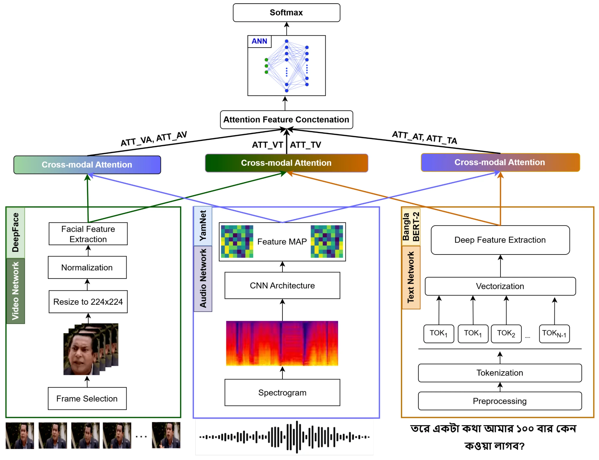
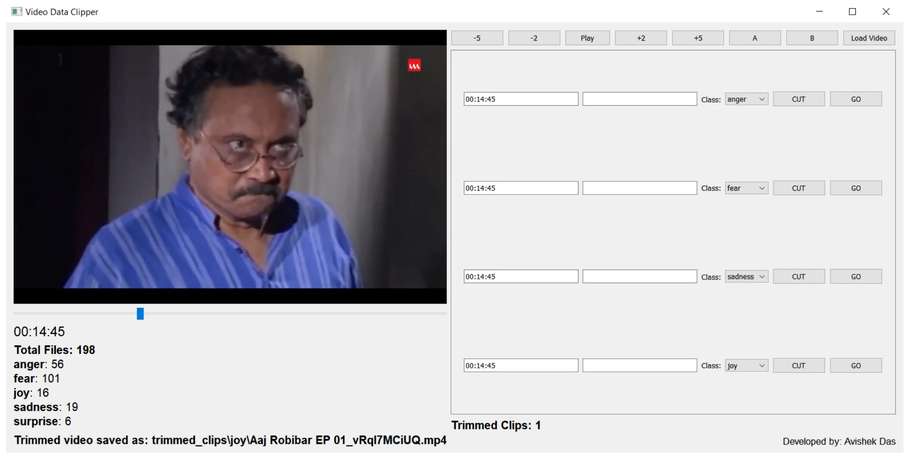

# AVaTER: Fusing Audio, Visual, and Textual Modalities Using Cross-Modal Attention for Emotion Recognition

[](https://www.mdpi.com/1424-8220/24/18/5862)
[](https://doi.org/10.3390/s24185862)
[](https://ksuemailprod-my.sharepoint.com/:f:/g/personal/avishek_ksu_edu/IgBEBci79-nkTaT2JCOkyFeaAfgGsfwWfFf-BO3CvzTh1Q4?e=SaNgDz)

Official repository for **AVaTER**, published in *Sensors* 24(18), 5862 (2024). AVaTER is a multimodal emotion recognition framework that fuses audio, video, and text features with cross-modal attention. It is evaluated on **MAViT-Bangla**, a new multimodal Bangla emotion dataset. This repository also contains the video annotation tool used to build the dataset.

- 📄 **Paper:** [https://www.mdpi.com/1424-8220/24/18/5862](https://www.mdpi.com/1424-8220/24/18/5862)
- 📁 **Dataset:** [MAViT-Bangla (SharePoint)](https://ksuemailprod-my.sharepoint.com/:f:/g/personal/avishek_ksu_edu/IgBEBci79-nkTaT2JCOkyFeaAfgGsfwWfFf-BO3CvzTh1Q4?e=SaNgDz)

> **Please use appropriate citation if you use the dataset.** See [Citation](#citation).

## Contents

- [Overview](#overview)
- [Dataset: MAViT-Bangla](#dataset-mavit-bangla)
- [AVaTER framework](#avater-framework)
- [Repository structure](#repository-structure)
- [Annotation tool](#annotation-tool)
  - [Features](#features)
  - [Requirements](#requirements)
  - [Installation](#installation)
  - [Usage](#usage)
  - [Output](#output)
  - [Customizing classes](#customizing-classes)
- [Citation](#citation)
- [Author](#author)

## Overview

Multimodal emotion classification identifies human emotions by combining several sources, such as audio, video, and text. Each modality contributes complementary cues. Two challenges stand out: modalities differ in character and noise level, which makes them hard to integrate, and large annotated multimodal datasets are scarce for Bangla. This work addresses both:

- **MAViT-Bangla** (Multimodal Audio Video Text Bangla dataset): 1,002 samples, each with audio, video, and text
- **AVaTER**: an audio, video, and textual emotion recognition framework that applies cross-modal attention between unimodal features. It reaches an **F1-score of 0.64**, a significant improvement over unimodal methods.

## Dataset: MAViT-Bangla

| | |
| --- | --- |
| Samples | 1,002 |
| Modalities | Audio, video, text |
| Language | Bangla |
| Emotion categories | Includes anger, fear, joy, and sadness |
| Download | [SharePoint folder](https://ksuemailprod-my.sharepoint.com/:f:/g/personal/avishek_ksu_edu/IgBEBci79-nkTaT2JCOkyFeaAfgGsfwWfFf-BO3CvzTh1Q4?e=SaNgDz) |

The clips were cut and labelled with the [annotation tool](#annotation-tool) in this repository.

> **Please use appropriate citation if you use the dataset.** See [Citation](#citation).

## AVaTER framework

<p align="center">
  
</p>

- **Video network:** frame selection → resize to 224×224 → normalization → facial feature extraction with **DeepFace**
- **Audio network:** spectrogram → CNN (**YamNet**) → feature map
- **Text network:** preprocessing → tokenization → vectorization → deep feature extraction with **BanglaBERT-2**
- **Fusion:** pairwise cross-modal attention between every pair of modalities (ATT_VA, ATT_AV, ATT_VT, ATT_TV, ATT_AT, ATT_TA). The attention features are concatenated and passed through an ANN with a softmax classifier.

## Repository structure

```
AVaTER/
├── README.md
├── assets/                 # Figures used in this README
└── Annotation Tool/
    ├── video_clipper.py    # PyQt5 + VLC annotation / clipping GUI
    ├── classes.txt         # Label set shown in the class dropdown
    ├── requirements.txt    # Pinned Python dependencies
    └── README.md
```

## Annotation tool

`Annotation Tool/video_clipper.py` opens a GUI window titled **Video Data Clipper**. It is the tool used to build MAViT-Bangla.

<p align="center">
  
</p>

### Features

- Plays `.mp4`, `.avi` and `.mkv` videos through VLC, with a seek slider and a live `HH:MM:SS` timestamp
- Skip buttons: −5 s, −2 s, +2 s and +5 s
- **A** / **B** buttons to set a segment's start and end at the current playback time
- An editable row for each segment: start time, end time, class dropdown, **CUT** (export the clip) and **GO** (jump to the start time)
- Exports clips with FFmpeg (via MoviePy) into `trimmed_clips/<class>/`
- Shows clip counts per class and in total, plus the number of clips cut this session
- Logs every cut to `trim_operations_log.csv`

### Requirements

- Python 3
- [VLC media player](https://www.videolan.org/vlc/) installed on the system (required by `python-vlc`)
- The Python packages in [`Annotation Tool/requirements.txt`](Annotation%20Tool/requirements.txt). The main ones are `PyQt5`, `python-vlc`, `moviepy` and `imageio-ffmpeg`.

> **Note:** `requirements.txt` pins Windows-only packages (`pywin32`, `pywin32-ctypes`). On macOS or Linux, remove those lines or install the core packages directly (see below).

### Installation

```bash
git clone https://github.com/avishek-018/AVaTER.git
cd "AVaTER/Annotation Tool"
pip install -r requirements.txt
```

On macOS or Linux, install just the core dependencies instead:

```bash
pip install PyQt5 python-vlc moviepy==1.0.3 imageio-ffmpeg
```

### Usage

Run the tool from inside the `Annotation Tool` folder, because it reads `classes.txt` from the current directory and exits if the file is missing:

```bash
cd "Annotation Tool"
python video_clipper.py
```

1. Click **Load Video** and choose a video file.
2. Click **Play**, and use the slider or the ±2 / ±5 buttons to navigate.
3. At the start of a segment, press **A**. This adds a new row with the start time filled in.
4. At the end of the segment, press **B**. This fills the end time of the most recent row.
5. Choose the emotion class from the row's dropdown. Edit the times by hand if needed (format `HH:MM:SS`).
6. Press **CUT** to export the clip. The row disappears and the counters update. **GO** jumps playback to that row's start time.

### Output

All output is written relative to the folder the tool is run from:

| Path | Contents |
| --- | --- |
| `trimmed_clips/<class>/<source-name>_<random-id>.mp4` | One exported clip per cut, grouped by class |
| `trim_operations_log.csv` | One line per cut: `start, end, class, source video, output file` (no header row) |

### Customizing classes

The dropdown is populated from `classes.txt`, one label per line. The default label set is:

```
joy
anger
fear
sadness
surprise
neutral
```

Edit this file to use a different label set.

## Citation

If you use the MAViT-Bangla dataset, the AVaTER framework, or the annotation tool, please cite:

```bibtex
@Article{s24185862,
  AUTHOR = {Das, Avishek and Sarma, Moumita Sen and Hoque, Mohammed Moshiul and Siddique, Nazmul and Dewan, M. Ali Akber},
  TITLE = {AVaTER: Fusing Audio, Visual, and Textual Modalities Using Cross-Modal Attention for Emotion Recognition},
  JOURNAL = {Sensors},
  VOLUME = {24},
  YEAR = {2024},
  NUMBER = {18},
  ARTICLE-NUMBER = {5862},
  URL = {https://www.mdpi.com/1424-8220/24/18/5862},
  PubMedID = {39338607},
  ISSN = {1424-8220},
  DOI = {10.3390/s24185862}
}
```

## Author

Developed by **Avishek Das** ([@avishek-018](https://github.com/avishek-018)).
